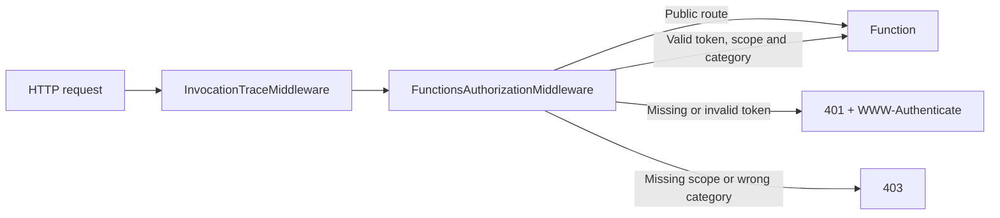

# Azure Functions app on Flex Consumption

The `api-functions` service holds the business logic that does not fit plain table CRUD: checkout, order processing, carts, passwords, email, AI content, search, simulations, manufacturing, warehouse, supply chain and real-time push. It is a .NET 10 isolated-worker app in [`api-functions/`](../../api-functions/).

## What it contains

The app defines **245 functions**:

| Trigger | Count | Examples |
|---|---|---|
| HTTP | 200 | `CreateOrderHeader`, `SemanticSearch`, `ManufacturingBegin` |
| Queue | 15 | `ProcessSalesOrderStatus_QueueTrigger`, `ManufacturingAgentQueue_QueueTrigger`, `WorkOrderOperationProcessor` |
| Timer | 6 | see below |
| SQL trigger | 2 | `OrderPlacedSqlTrigger` on `Sales.SalesOrderHeader`; `DatabaseChanges` on `dbo.RealtimeNotificationOutbox` |
| Durable orchestrator | 5 | `TranslateLanguageFile_Orchestrator`, `GenerateProductNameEmbeddings_Orchestrator` |
| Durable activity | 17 | `TranslateSectionActivity`, `SaveNameEmbeddingsActivity` |

Every function, with its route, authorization tier, scope and Web PubSub event, is listed in the [Functions routes reference](../reference/functions-routes.md). Queues and tables are in [storage resources](../reference/storage-resources.md).

### Timers

| Function | Schedule (UTC) | Does |
|---|---|---|
| `ShoppingSimulator_Timer` | every minute | Runs simulator ticks and stops the simulator after its configured duration |
| `ExpireAbandonedReviewJobs` | every minute | Marks abandoned review generation jobs as expired |
| `CleanupExpiredGuestCarts` | every 10 minutes | Deletes expired guest carts |
| `OrderDelivery_Timer` | hourly | Moves Shipped (5) orders to Delivered (7) after the configured delivery window |
| `CleanupDatabaseNotifications` | daily 03:00 | Deletes processed real-time outbox rows older than 7 days |
| `ArchiveTransactionHistoryTimer` | Sundays 02:00 | Archives old `Production.TransactionHistory` rows |

### Durable Functions

[`host.json`](../../api-functions/host.json) sets the Durable task hub to `AdventureWorksFunctions`, `defaultVersion` to `push-v1` and `versionMatchStrategy` to `CurrentOrOlder`, so new instances run the current version and older histories still replay.

- `TranslateLanguageFile_HttpStart` and `GenerateProductNameEmbeddings_HttpStart` start orchestrations that report progress through the `utilities` Web PubSub group.
- `GenerateProductEmbeddings_Orchestrator`, `GenerateProductReviewEmbeddings_Orchestrator` and `TranslateProductDescriptions_Orchestrator` are defined, but their HTTP starters do not schedule them.

Orchestration progress is pushed, not polled. See [real-time eventing](../architecture/realtime-eventing.md).

### Queue settings

`host.json` sets `batchSize` 16, `maxDequeueCount` 5 and `visibilityTimeout` 30 minutes. After five failed attempts a message moves to the queue's `-poison` queue.

## Hosting

| Setting | Value |
|---|---|
| Resource | Function App `av-func-*` ([`flex-api-functions.bicep`](../../infra/modules/flex-api-functions.bicep)) |
| Plan | Flex Consumption (FC1), Linux, .NET 10 isolated |
| Scale | Up to 5 instances, 2,048 MB each |
| Always ready | One instance each for `OrderPlacedSqlTrigger` and `DatabaseChanges` (two total), so the SQL listeners keep running |
| Network | VNet integration to reach private SQL and storage |
| Identity | Runtime user-assigned managed identity for SQL, storage, Web PubSub, email and Foundry |
| Deployment | `azd deploy api-functions --no-prompt` publishes the project directly (`host: function`); there is no container image |

The `api-functions` postdeploy hook, [`api-functions-postdeploy.sh`](../../scripts/hooks/api-functions-postdeploy.sh), writes Foundry agent IDs, `MCP_SERVICE_URL` and `MANUFACTURING_AGENT_ENDPOINT` to the app settings.

## Request pipeline and authorization

Every HTTP trigger uses `AuthorizationLevel.Anonymous`. Authorization happens in worker middleware registered in [`Program.cs`](../../api-functions/Program.cs):



- [`FunctionAuthorizationRegistry.cs`](../../api-functions/Auth/FunctionAuthorizationRegistry.cs) classifies every HTTP function: **Public** (20), **Authenticated** (1, `NegotiateWebPubSub`), **Consumer** (17, the caller's own data) and **Internal** (162, staff roles). In enforced mode an unclassified function is denied. `FunctionAuthorizationRegistryTests` in `api-functions.Tests` checks that every function is classified.
- `FUNCTIONS_OAUTH_MODE` selects `disabled` (the code default), `audit` (log decisions, do not block) or `enforced`. Bicep sets `enforced`.
- Tokens are api-mcp JWTs with audience `<issuer>/functions` (`FUNCTIONS_JWT_ISSUER`, `FUNCTIONS_JWT_AUDIENCE`). The OpenID metadata address defaults to `<issuer>/.well-known/openid-configuration`.
- Internal routes require an internal user category plus the route's scope; consumer routes check ownership against the token's `business_entity_id` or `customer_id`.

See the [route scope matrix](../features/functions-oauth/ROUTE_SCOPE_MATRIX.md) and [Functions OAuth](../features/functions-oauth/README.md).

### Calling a route

```bash
python3 scripts/utilities/azure-auth.py request \
  --identity manufacturing --resource functions --path /api/manufacturing/status
```

Use `--identity admin` for orders, customers and reporting routes. See [authenticated local scripts](../testing/AZURE_AUTHENTICATED_SCRIPTS.md).

### GET routes with side effects

Some GET routes change state. Treat them as writes when testing:

- `OrderDelivery_HttpTrigger` (`/api/orders/delivery/trigger`) promotes shipped orders to delivered.
- `GetVerifiedReviewsStatus` resets a stale running flag.
- `GetManufacturingAgentConfig` switches the agent to Off when its auto-shutoff time has passed.
- `ArchiveTransactionHistoryHttp` (`/api/archive/trigger`) runs the transaction history archive.
- `TranslateLanguageFile_Terminate` accepts GET and terminates an orchestration.
- Financial, workforce, warehouse, planning and supply-chain reads seed their tables or vendor stock on first use.

The [Functions routes reference](../reference/functions-routes.md) marks each of these in its Notes column.

## Real-time push

`WebPubSubService` sends events to Web PubSub groups after mutations. Services that store state in Azure Tables use `NotifyingTableClient`, which sends a coalesced `state-changed` event after each write. SQL triggers write direct DAB changes to an outbox that `DatabaseChanges` turns into `database-changed` events. `GET /api/webpubsub/negotiate` returns a client URL for the groups the caller's scopes allow.

See [Web PubSub events](../reference/webpubsub-events.md) and [real-time eventing](../architecture/realtime-eventing.md).

## Code structure and dependency injection

- `Functions/` holds the trigger classes, `Services/` the business logic, `Models/` the DTOs and `Auth/` the authorization middleware and registry.
- `Program.cs` registers services. Services that need SQL read `SQL_CONNECTION_STRING`, which uses `Authentication=Active Directory Default` (managed identity in Azure, your Azure CLI sign-in locally):

```csharp
builder.Services.AddScoped<AddressService>(sp =>
{
    var configuration = sp.GetRequiredService<IConfiguration>();
    var connectionString = configuration["SQL_CONNECTION_STRING"]
        ?? throw new InvalidOperationException("SQL_CONNECTION_STRING environment variable is not set");
    return new AddressService(connectionString);
});
```

- Storage queues, tables and containers are created by Bicep, never by code. Do not call `CreateIfNotExists*`. To add one, follow [storage resources](../reference/storage-resources.md#adding-a-storage-resource).

Key settings are listed in [environment variables](../reference/environment-variables.md#azure-functions-api-functions).

## Health, OpenAPI and status endpoints

| Route | Purpose |
|---|---|
| `GET /api/health` | Liveness |
| `GET /api/health/readiness` | Checks SQL and the expected queues, tables and containers; returns a sanitized result |
| `GET /api/seed/status` | Reads seed-job progress from the seed log share |
| `GET /api/openapi.json`, `GET /api/swagger/ui` | Hand-maintained OpenAPI document covering a subset of routes; use the routes reference for the full list |
| `GET /api/sitemap.xml` | XML sitemap of catalog pages |

On startup, `Program.cs` also checks that every expected storage resource exists and logs a warning for any that is missing. See [health diagnostics](../features/monitoring/HEALTH_DIAGNOSTICS.md).

## Telemetry

- **Trace correlation.** [`InvocationTraceMiddleware`](../../api-functions/Functions/InvocationTraceMiddleware.cs) runs first for every invocation. It makes the worker's trace match the host request's W3C trace, so custom events, SQL dependencies and outbound calls share the request's `operation_Id`.
- **Sampling.** `host.json` never samples requests, events or exceptions. The worker re-adds adaptive sampling at 20 items per second and never samples events or exceptions.
- **SQL identity evidence.** The shared [`SqlPrincipalTelemetry`](../../api-mcp/AdventureWorks/Telemetry/SqlPrincipalTelemetry.cs) service (compiled from api-mcp) emits `Sql.SessionPrincipal` with scope `function:<name>`. The event compares the principal behind `SQL_CONNECTION_STRING` with `AZURE_CLIENT_ID`, using hashes only.
- **Foundry errors.** Failed Responses API calls log the error code and type, rate-limit headers and request sizes, never the response body.

Custom events and queries are listed in [monitoring](../operations/monitoring.md).

## Running locally

1. Copy [`local.settings.example.json`](../../api-functions/local.settings.example.json) to `local.settings.json` and fill in values from `azd env get-value`. Never commit the populated file.
2. Set `MCP_SERVICE_URL` to the deployed api-mcp (`azd env get-value MCP_SERVICE_URL --no-prompt`).
3. Run the VS Code task **func: host start**, which builds first.

The deployed SQL database and storage account are private, so a local host cannot reach them from outside the VNet. Test changes by deploying with `azd deploy api-functions --no-prompt`.

## Tests

`api-functions.Tests/` contains the unit tests, including the authorization registry tests:

```bash
dotnet test api-functions.Tests
```

See the [testing strategy](../testing/testing-strategy.md).
