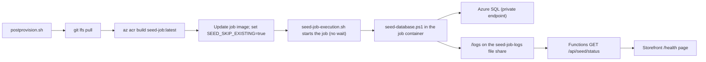

# Database seed job

The seed job builds and loads the AdventureWorks database for each new demo environment. It is an Azure Container Apps job (`av-seed-job-*`) that runs the PowerShell script [`seed-job/seed-database.ps1`](../../seed-job/seed-database.ps1). It is not an azd service; the `postprovision` hook builds and starts it.

For full operator detail, including overlay imports and verification commands, see the [seed job README](../../seed-job/README.md).

## How it runs



- The image is based on `mcr.microsoft.com/azure-powershell` and is built in ACR by `postprovision.sh` in the background while other setup continues.
- [`seed-job-execution.sh`](../../scripts/hooks/seed-job-execution.sh) starts an execution and returns. `azd up` does not wait for seeding to finish, so the site may be unavailable or incomplete until it does.
- A failure to build, update or start the job fails the hook. Failures during seeding appear in the job logs and on the `/health` page, not in the `azd up` result.

## Identity and access

- The job uses its own **seed managed identity** (`av-seed-identity-*`). Bicep makes it the server's Microsoft Entra administrator, and it pulls the image from ACR.
- It reaches SQL through the Container Apps private network; public SQL access is never needed.
- [`RuntimeDatabaseAccess.psm1`](../../seed-job/RuntimeDatabaseAccess.psm1) creates the runtime identity's database user from its client ID (`CREATE USER ... WITH SID = ..., TYPE = E`, no Microsoft Graph lookup) and grants:
  - `db_datareader`, `db_datawriter` and `EXECUTE`;
  - `VIEW CHANGE TRACKING` on `Sales.SalesOrderHeader`;
  - `REFERENCES` and `VIEW DEFINITION` on the manufacturing instructions XML schema collection;
  - object-level `VIEW DEFINITION` on tables with default or computed columns, so DAB sees server defaults.

## What a full seed does

On an empty database, the job:

1. Drops any existing user objects and runs [`AdventureWorks.sql`](../../seed-job/sql/AdventureWorks.sql) and [`AdventureWorks-AI.sql`](../../seed-job/sql/AdventureWorks-AI.sql) to create the schema, including `VECTOR(1536)` embedding columns and search views.
2. Uploads the product images in [`seed-job/images/`](../../seed-job/images/) (1,770 PNG files) to `Production.ProductPhoto`.
3. Bulk-loads 88 CSV-to-table batches from [`seed-job/sql/`](../../seed-job/sql/): the original AdventureWorks data plus AI-generated reviews, descriptions, translations, embeddings, warehouse staff, purchasing and production data.
4. Imports the approved manufacturing instruction and illustration overlays ([`ManufacturingOverlays.psm1`](../../seed-job/ManufacturingOverlays.psm1)).
5. Creates the demo sign-ins used by [authenticated scripts](../testing/AZURE_AUTHENTICATED_SCRIPTS.md) (Ken, `executive-admin`, and Peter, `manufacturing-engineer`).
6. Shifts order and history dates forward so the data looks current.
7. Enables Change Tracking on the database and `Sales.SalesOrderHeader`, and creates `dbo.RealtimeNotificationOutbox` and its DML triggers for real-time push.
8. Creates the guest-cart schema and applies the runtime identity grants.

The job also pre-creates the `az_func` lease tables used by the Functions SQL trigger listeners, so the runtime identity needs no DDL rights. See [Web PubSub events](../reference/webpubsub-events.md) for the outbox and [data stores](../architecture/data-stores.md) for the schema.

### Existing databases

The job sets `SEED_SKIP_EXISTING=true`. If the core tables (`ProductModel`, `Product`, `Person` and `SalesOrderHeader`) already contain data, the job keeps the data and only applies the guest-cart schema, manufacturing overlays and runtime grants. If only some of them contain data, it stops with an error instead of wiping anything.

### Targeted modes

`seed-database.ps1` also accepts `-ManufacturingOverlaysOnly` (optionally with `-VerifyOnly`), `-RealtimeNotificationsOnly` and `-GuestCartsOnly`. They are used for tests and content publication. Schema or seed changes for the demo go into the full seed and reach Azure through a recreated environment; do not run targeted modes to repair a deployed environment.

## Hosting

| Setting | Value |
|---|---|
| Resource | Container Apps job ([`aca-seed-job.bicep`](../../infra/modules/aca-seed-job.bicep)) |
| Size | 2 CPU, 4 Gi |
| Trigger | Manual |
| Timeout | 2,000 seconds per execution, no retries |
| Logs | `/logs/seed-<timestamp>.log` on the `seed-job-logs` Azure Files share, mounted with the environment's managed identity (preview SMB OAuth mount) |
| Telemetry | Application Insights custom events `Sql.SessionPrincipal` and `Seed.Completed` from [`SeedTelemetry.psm1`](../../seed-job/SeedTelemetry.psm1) |

Settings are listed in [environment variables](../reference/environment-variables.md#seed-job-seed-job).

## Monitoring

- Open the storefront `/health` page. It reads the latest log through `GET /api/seed/status` and shows whether the job is running, finished or failed.
- List executions with the Azure CLI:

```bash
az containerapp job execution list \
  --name "$(azd env get-value SERVICE_SEED_JOB_NAME --no-prompt)" \
  --resource-group "$(azd env get-value AZURE_RESOURCE_GROUP --no-prompt)" \
  --output table
```

- Query Application Insights (cloud role `seed-job`). Each run uses one operation ID and sends two custom events:
  - `Sql.SessionPrincipal`, sent after the SQL connection opens. It has scope `seed:<mode>` and compares the SQL principal with the seed identity's `AZURE_CLIENT_ID` (as hashes only), so `PrincipalMatch = match` confirms the job connected as the seed identity.
  - `Seed.Completed`, sent when the run finishes, successfully or not. It carries `Mode` (`full`, `guest-carts`, `realtime-notifications`, `manufacturing-overlays` or `manufacturing-overlays-verify`), `Outcome` (`succeeded` or `failed`), `DurationSeconds` and `ScriptVersion` (the first 8 characters of the script's SHA-256 hash). A run that fails before it reaches the SQL connection step, for example because it can't get a token, sends neither event, so check the log or execution status too.

  Telemetry is turned off when `APPLICATIONINSIGHTS_CONNECTION_STRING` is missing or invalid. Send failures are ignored and never change the seed result. No SQL text, connection strings, tokens or row data are sent. The [monitoring](../operations/monitoring.md#diagnostic-queries) page has a KQL query for seed runs.

See [health diagnostics](../features/monitoring/HEALTH_DIAGNOSTICS.md) and [monitoring](../operations/monitoring.md).

## Changing seed data

- Edit the SQL or CSV files in `seed-job/sql/`, or the image set in `seed-job/images/`. Large files (such as `ProductNames-ai.csv`) are stored with Git LFS, which `postprovision.sh` pulls before building the image.
- Many CSV files are produced by one-off scripts; see [seed data generation](../operations/seed-data-generation.md) and the [scripts reference](../reference/scripts.md).
- Seed changes take effect in a new environment. Ask the environment owner to recreate the demo; do not run seed or grant repairs against a deployed database.

## Tests

[`seed-job/tests/`](../../seed-job/tests/) contains Pester tests (`Test-SeedLifecycle.ps1`, `Test-RuntimeDatabaseAccess.ps1`, `Test-ManufacturingOverlays.ps1`, `Test-SeedTelemetry.ps1`) and Python tests (`test_seed_deployment.py`, `test_seed_log_mount.py`, `test_foundry_dependencies.py`).
