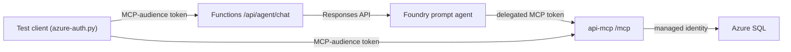

# AI and MCP testing guide

This guide shows how to test the deployed MCP server and the AI endpoints in Azure Functions. Every protected call uses an OAuth token from [`azure-auth.py`](AZURE_AUTHENTICATED_SCRIPTS.md) that is bound to the target resource. Direct MCP calls cost nothing beyond normal API traffic. Chat and agent calls make **billable** Foundry inferences, so run them on purpose.

## How the pieces connect



- api-mcp serves **Streamable HTTP at `/mcp` only**; there is no separate SSE transport endpoint. Clients must accept both `application/json` and `text/event-stream`.
- Without a token, `POST /mcp` returns `401` with a `WWW-Authenticate` header whose `resource_metadata` points to the protected-resource metadata document.
- `tools/list` returns all 63 tools to every authenticated caller. Authorization happens on each `tools/call`, based on the token's scopes, user category and record ownership. See the [tool scope matrix](../features/mcp-oauth/TOOL_SCOPE_MATRIX.md).
- Tool names are snake_case, for example `search_products`, `get_customer_orders` and `get_business_stats`.
- Functions reaches Foundry agents through the Responses API (`FoundryAgentClient`). For agent definitions, see [Foundry agents](../features/ai/foundry-agents.md).

## Prerequisites

- A deployed environment selected in azd, with the seed job complete.
- Python 3, plus `jq` for the examples.
- The seeded identities described in [Authenticated scripts](AZURE_AUTHENTICATED_SCRIPTS.md): `manufacturing` (Peter) and `admin` (Ken). For customer-owned tools, use a disposable consumer account.

## Direct MCP calls

`azure-auth.py request --resource mcp` gets an MCP-audience token and adds the required `Accept` header. The token stays in memory.

```bash
# List tools (all 63 are listed; authorization applies per call).
python3 scripts/utilities/azure-auth.py request \
  --identity manufacturing --resource mcp --path /mcp --method POST \
  --data '{"jsonrpc":"2.0","id":1,"method":"tools/list"}'

# Call a catalog tool (products.read).
python3 scripts/utilities/azure-auth.py request \
  --identity manufacturing --resource mcp --path /mcp --method POST \
  --data '{"jsonrpc":"2.0","id":2,"method":"tools/call","params":{"name":"search_products","arguments":{"searchTerm":"helmet"}}}'

# Call an internal reporting tool (sales.read) as Ken.
python3 scripts/utilities/azure-auth.py request \
  --identity admin --resource mcp --path /mcp --method POST \
  --data '{"jsonrpc":"2.0","id":3,"method":"tools/call","params":{"name":"get_business_stats","arguments":{}}}'
```

The response may arrive as a server-sent event (`event:`/`data:` lines). If so, parse the JSON from the `data:` line. A denied tool call returns a tool error naming the missing scope or category. The same call as Peter tests denial, because Peter lacks `sales.read`. Each decision is logged as the `McpToolAuthorization` event; see [Monitoring](../operations/monitoring.md#api-mcp-and-seed-job).

Customer-owned tools such as `get_customer_orders` and `get_order_details` check ownership against the signed-in consumer. Test them with a disposable consumer token. Passing another customer's ID is denied.

For interactive exploration, the deployed MCP Inspector (`MCP_INSPECTOR_URL`) uses the same OAuth server.

## AI endpoints in Functions

| Route | Auth | Notes |
| --- | --- | --- |
| `GET /api/agent/status` | Anonymous | Returns `status` and the enabled `features` list. Makes no AI call. |
| `POST /api/agent/chat` | **MCP-audience** bearer token | The caller's identity comes from the token, and any `customerId` in the body is ignored. `isAdmin: true` requires an internal user with `sales.read`. Messages are limited to 4,000 characters. |
| `GET /api/helpme/questions`, `POST /api/helpme/recommend` | Anonymous | The storefront help-me-choose wizard. `recommend` makes an AI call. |
| `POST /api/GenerateOrderWithAI` | Internal, `admin.write` | Generates a simulated order with the order agent, so it is both a mutation and an AI call |

For all routes and scopes, see the [Functions routes reference](../reference/functions-routes.md).

```bash
# Status (no token, no AI call).
curl -s "$(azd env get-value API_FUNCTIONS_URL --no-prompt)/api/agent/status" | jq '{status, features}'
```

A chat turn is billable and needs an MCP-audience token sent to the **Functions** host. `request --resource mcp` targets the MCP host, so mint the token and send it with curl instead. Supply the headers on stdin, as shown in [Use a token with curl](AZURE_AUTHENTICATED_SCRIPTS.md#use-a-token-with-curl-or-another-local-script):

```bash
set -euo pipefail
MCP_TOKEN=$(python3 scripts/utilities/azure-auth.py token --identity admin --resource mcp)
FUNCTIONS_URL=$(azd env get-value API_FUNCTIONS_URL --no-prompt)
printf 'Authorization: Bearer %s\nContent-Type: application/json\n' "$MCP_TOKEN" |
  curl --silent --show-error --fail-with-body --max-time 180 --header @- \
    --data '{"message":"Summarize sales by order status.","isAdmin":true}' \
    "${FUNCTIONS_URL%/}/api/agent/chat" | jq '{threadId, toolsUsed, response}'
unset MCP_TOKEN
```

The response's `threadId` is a Foundry response ID for the same caller and agent. To continue the conversation, send it back as `threadId`.

## Scripted checks

| Script | What it covers | Cost |
| --- | --- | --- |
| `bash tests/scripts/test-ai-chat-and-mcp.sh` | Runs the `validate.py --chat` profile: SQL-backed availability, missing-scope denial and customer tool ownership | No inference |
| `... --customer-agent-canary` | One customer-chat inference, with trace correlation to the delegated MCP decision | Billable |
| `... --admin-agent-canary` | One admin-chat inference that checks the reviewed read-only tool list | Billable |
| `... --customer-agent-canary --agent-tool-sweep` (or with `--admin-agent-canary`) | Also prompts each reviewed chat tool not yet correlated and checks the SQL session principal in telemetry | Billable, several requests |

[Chat and MCP authentication testing](AI_CHAT_MCP_TESTING.md) describes the evidence each profile collects. [`tests/scripts/README.md`](../../tests/scripts/README.md) lists the prerequisites.

`tests/scripts/test-ai-and-mcp-complete.sh` comes from before the OAuth rollout. It sends no bearer tokens, so protected routes return `401`. Its MCP section labels the transport "SSE", while the current server uses Streamable HTTP at `/mcp`. Use `test-ai-chat-and-mcp.sh` and the direct calls above instead.

## Agent behavior checks

These are manual checks, and each makes billable calls:

- **Caller binding:** ask the chat "What was my last order?" as two different consumers. Each answer must reflect only that caller's orders, because identity comes from the token.
- **Tool use:** with the canaries, a narrative answer alone is not evidence. The test requires a completed MCP result that a trace correlates with the delegated authorization decision.
- **Guardrails:** platform content-filter blocks return no partial output, emit `Agent.GuardrailBlocked` and reset the conversation continuation.
- **Telemetry:** query `customEvents` for `Agent.ChatSuccess` and `customMetrics` for `Foundry.Responses.InputTokens`. See [Monitoring](../operations/monitoring.md#diagnostic-queries).

Never enable shell tracing, print tokens, or copy private responses into reports.

## Related

- [Chat and MCP authentication testing](AI_CHAT_MCP_TESTING.md)
- [Authenticated scripts](AZURE_AUTHENTICATED_SCRIPTS.md)
- [Testing strategy](testing-strategy.md)
- [MCP tool scope matrix](../features/mcp-oauth/TOOL_SCOPE_MATRIX.md)
- [Foundry agents](../features/ai/foundry-agents.md)
- [api-mcp service](../services/api-mcp.md)
