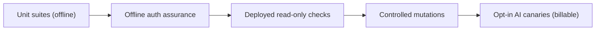

# Testing strategy

Testing has four layers. Fast unit suites need no Azure access. Offline authentication assurance checks authorization contracts without deployed calls. Deployed checks run against the selected azd environment. Opt-in canaries make billable AI calls. Begin with the cheapest layer that covers your change. [`tests/scripts/README.md`](../../tests/scripts/README.md) has each script's prerequisites and command.



## Unit suites

These suites need no Azure access. The last column shows whether the
[offline assurance profile](#offline-authentication-assurance) also runs them.

| Suite | Proves | Command | In offline profile |
| --- | --- | --- | --- |
| [`api-functions.Tests`](../../api-functions.Tests/) (xUnit) | Functions services, OAuth middleware, route policies and ownership handlers | `dotnet test api-functions.Tests/api-functions.Tests.csproj` | Yes |
| [`api-mcp/AdventureWorks.Tests`](../../api-mcp/AdventureWorks.Tests/) (xUnit) | OAuth server, MCP tool dispatch and task ownership, SQL principal telemetry | `dotnet test api-mcp/AdventureWorks.Tests/AdventureWorks.Tests.csproj` | Yes |
| `app-manufacturing` (Vitest) | Manufacturing UI components, hooks and API client | `npm --prefix app-manufacturing test` | Three files (Web PubSub hook, DAB fetch, shortages panel) |
| Storefront scripts (`node --test`) | Health page checks and sale product card | `cd app && node --test scripts/health-checks.test.mjs scripts/sale-product-model-card.test.mjs` | No |
| `mcp-inspector` gateway (`node --test`) | Hosted Inspector gateway sign-in and proxy rules | `npm --prefix mcp-inspector test` | Yes |
| Frontend auth and live-update regressions (`node --test`) | Route guards, carts, reviews, chat tokens, Web PubSub batching and the no-polling rule | `node --experimental-vm-modules --test tests/scripts/test-<name>.mjs` | Yes |
| Frontend telemetry envelopes, receipt download (`node --test`) | Telemetry payload parsing; admin receipt download handling | `node --test tests/scripts/test-frontend-telemetry-envelopes.mjs`; `node --experimental-vm-modules --test tests/scripts/test-receipt-download.mjs` | No |
| Assurance engine (`tests/auth`, `unittest`) | Contract parsing, canaries, agent tool sweep, fixtures and report logic | `python3 -B -m unittest discover -s tests/auth -p 'test_*.py'` (needs `pyyaml` and `cryptography`) | Yes |
| Repository scripts (`tests/scripts`, `unittest`) | Auth helper, deployment hooks, GitHub workflow setup, agent tool lists, manufacturing content scripts, localized SQL guard | `python3 -B -m unittest discover -s tests/scripts -p 'test_*.py'` | Five modules |
| Seed job (Python, `unittest`) | Seed deployment, log mount and Foundry dependencies | `python3 -B -m unittest discover -s seed-job/tests -p 'test_*.py'` | `test_seed*.py` |
| Seed job (PowerShell) | Manufacturing overlays, runtime database access, seed lifecycle and seed telemetry | `pwsh -NoLogo -NoProfile -File seed-job/tests/Test-<Name>.ps1` | No |
| Docs link checker (`node --test`) | Link and anchor checking used for these docs | `node --test scripts/utilities/check-docs-links.test.mjs` | No |
| Preup model selection (Bash) | Chat-model ranking, capacity and fallback | `bash tests/scripts/test-chat-model-selection.sh` | No |

`dotnet test AdventureWorks.sln` runs both .NET suites. `seed-job/tests/test_foundry_dependencies.py` needs the Bicep CLI at `~/.azure/bin/bicep`; `az bicep install` puts it there. [`tests/scripts/README.md`](../../tests/scripts/README.md#offline-tests) lists every offline file.

All three frontends have an `npm run lint` script. `app-admin` has lint only and no unit tests, and no app has a separate type-check script. Run `npm run build`, which type-checks through Vite and TypeScript, when you change TypeScript types.

## Offline authentication assurance

```bash
bash tests/scripts/validate-auth.sh --offline [--functions-host] [--output DIR]
```

This profile needs no Azure login and makes no deployed calls. It runs, as one gate:

- the source contracts in `tests/auth/contracts.json` (route policies, DAB permissions, tool scopes)
- both .NET test projects, with exact-case gates on the middleware, ownership, guest-cart and MCP task-ownership tests
- the `tests/auth` unit tests, five `tests/scripts` Python modules and the seed-job `test_seed*.py` tests
- the frontend Node regressions, including the internal-session switching gate, three manufacturing Vitest files and the Inspector gateway tests

`--functions-host` adds the real Functions worker on loopback with blocked dependencies. It needs `func`, `azurite`, `dotnet`, `openssl`, `unshare`, `ip` and Linux namespace permission. Unit tests do not prove deployed route bindings, SQL grants or live token exchanges.

Evidence is written to the git-ignored `.auth-results/`. Exit codes are `0` (all applicable checks passed), `1` (a failure) and `2` (blocked: required evidence was unavailable).

## Real-time regression check

```bash
node --experimental-vm-modules --test tests/scripts/test-live-updates.mjs
```

This checks fixed-window event batching, in-flight follow-ups, reconnect and focus recovery, and cleanup. It also rejects recurring network polling across all three frontend source trees. Run it after any change to `useRealTimeUpdates`, `useWebPubSub` or `useLiveUpdates`.

## Deployed checks

These checks run against the selected azd environment. Protected endpoints need tokens from [`azure-auth.py`](AZURE_AUTHENTICATED_SCRIPTS.md). Prefer `--identity manufacturing` (Peter) for manufacturing and inventory work, and `--identity admin` (Ken) for customers, orders and reporting.

Some Functions `GET` routes change state, for example `bank/*`, `manufacturing/status`, `manufacturing/agent-config`, `generate-verified-reviews/status`, `orders/delivery/trigger`, `archive/trigger` and `TranslateLanguageFile_Terminate`. Never use them as read-only probes; the [full list](../../tests/scripts/README.md#side-effecting-get-routes) is in the scripts catalog.

| Check | Command | Side effects |
| --- | --- | --- |
| Health and readiness | `bash tests/scripts/test-health-diagnostics.sh` | Read-only |
| Infrastructure assurance | `bash tests/scripts/validate-auth.sh --infra` | Read-only |
| Live assurance | `bash tests/scripts/validate-auth.sh --live` (or `--all`, which adds `--offline` and `--infra`) | Controlled fixtures: retained consumer users, guest carts created and retired |
| Browser assurance | `bash tests/scripts/validate-auth.sh --browsers` | Cart fixtures, cleaned up |
| Customer chat and MCP authorization | `bash tests/scripts/test-ai-chat-and-mcp.sh` | Read-only, no inference. See [Chat and MCP authentication testing](AI_CHAT_MCP_TESTING.md). |
| Runtime identity probes | `test-runtime-rbac.py`, `test-runtime-sql.py`, `diagnose-dab-capacity.py` | Read-only by default; opt-in flags send one Web PubSub message or one email |
| Private-network job | `python3 tests/scripts/run-auth-assurance-job.py --preflight` | `--preflight` is read-only; other modes deploy a temporary job and may create fixtures |
| Auth smoke tests | `bash tests/scripts/auth-smoke-tests.sh` | One billable Generate Promotion call |
| Password flows | `test-password-functions.sh`, `test-password-reset-flow.sh` | Overwrite a disposable consumer's password; the reset flow can send email |

The `check-*-dab.ts` scripts run with `npx tsx`, which downloads `tsx` because it is not a repository dependency. They call DAB without a token, so they cover only anonymously readable entities.

## Opt-in AI canaries

AI canaries make potentially billable Foundry calls and are always explicit flags on an assurance profile. Run them only after deploying the matching MCP, agent-definition and Functions changes.

| Canary | Example | Cost and side effects |
| --- | --- | --- |
| Customer or admin chat | `bash tests/scripts/test-ai-chat-and-mcp.sh --customer-agent-canary` (or `--admin-agent-canary`) | One chat request each |
| Agent tool sweep | Add `--agent-tool-sweep` to a chat canary | One prompt per reviewed chat tool not yet correlated; checks the SQL session principal in telemetry |
| Focused agents | `validate-auth.sh --promotion-agent --promotion-agent-canary`, and likewise for catalog, email-content, product-content, manufacturing-content and analysis agents | One or two inferences; no email is sent |
| Hosted Manufacturing agent | `validate-auth.sh --live --hosted-agent-canary` | One no-tool request |
| Order cancellation | `validate-auth.sh --order-canary --order-cancellation-canary` | Creates and cancels two orders; disposable consumers and the cancelled orders remain |
| Generation agents | Add `--generation-agent-canary` to `--live` or to the order canary | Creates and keeps one AI-generated customer; with the order canary, also one AI order that is cancelled |

[`tests/scripts/README.md`](../../tests/scripts/README.md#opt-in-canaries) has each flag's prerequisites. [AI and MCP testing](AI_AND_MCP_TESTING_GUIDE.md) covers manual MCP calls and agent checks, and the [end-to-end authentication guide](../features/authentication/END_TO_END_AUTHENTICATION.md#agent-tool-sweep-and-generation-agent-canaries) describes the evidence.

## What CI covers

The [Build-Checker workflow](../operations/ci-cd.md#build-check) runs manually and weekly. Its offline authentication assurance job runs the `--offline` profile, so it covers every suite marked "Yes" in the [unit suites](#unit-suites) table. It also builds the containers, publishes Functions and builds the storefront. It does **not** run:

- the remaining Vitest files, storefront, seed PowerShell, docs link checker or other `tests/scripts` Python tests
- the linters
- any deployed check

The deployment workflow can optionally run the read-only `--infra` profile after deployment. Before you open a PR, run the unit suites and linters for every component you changed. For deployed behavior, run `azd deploy` and then the relevant read-only deployed checks.

## Test data and safety rules

- Never print tokens, refresh sessions or passwords, and never enable shell tracing while a token is in scope.
- Prefer read-only checks. Mutations, simulator starts and AI calls need a clear purpose and a cleanup step.
- Tests that need temporary persistent state may create a randomly named Azure Table in the demo storage account and must delete it in a `finally` path. Never touch provisioned application tables.
- Never repair a deployed environment to make a test pass. Fix the source and redeploy, or ask the user to recreate the environment.

## Related

- [Test script catalog](../../tests/scripts/README.md)
- [Authenticated scripts](AZURE_AUTHENTICATED_SCRIPTS.md)
- [AI and MCP testing](AI_AND_MCP_TESTING_GUIDE.md)
- [Chat and MCP authentication testing](AI_CHAT_MCP_TESTING.md)
- [Health diagnostics](../features/monitoring/HEALTH_DIAGNOSTICS.md)
- [CI/CD workflows](../operations/ci-cd.md)
